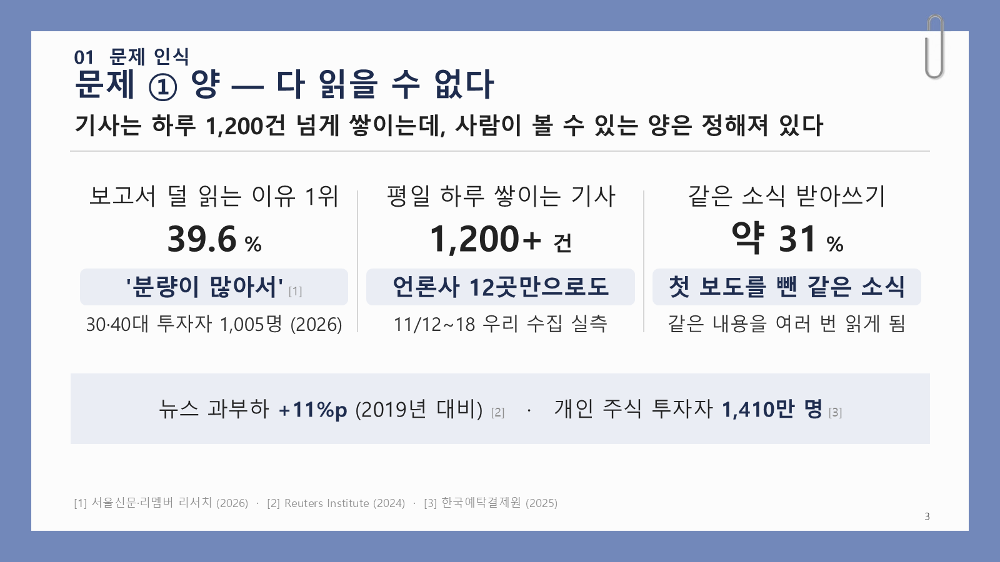
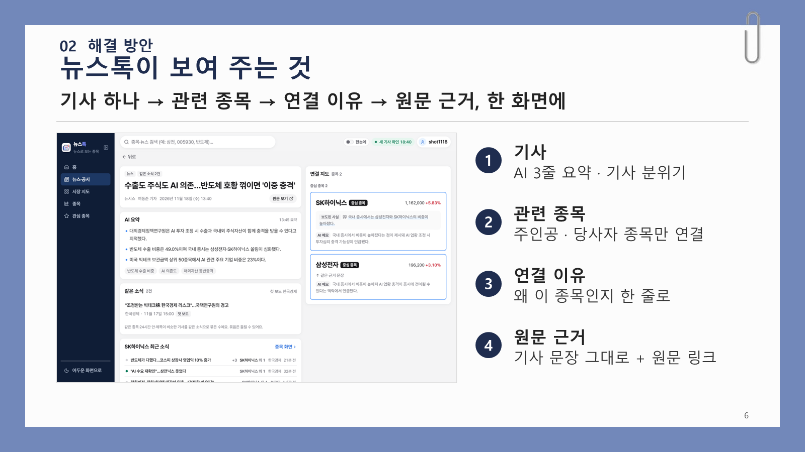
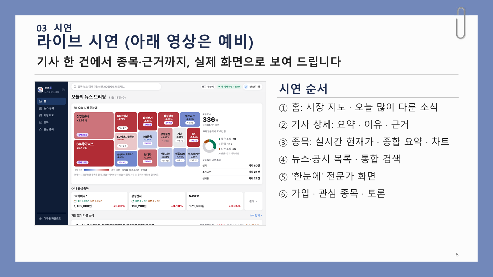
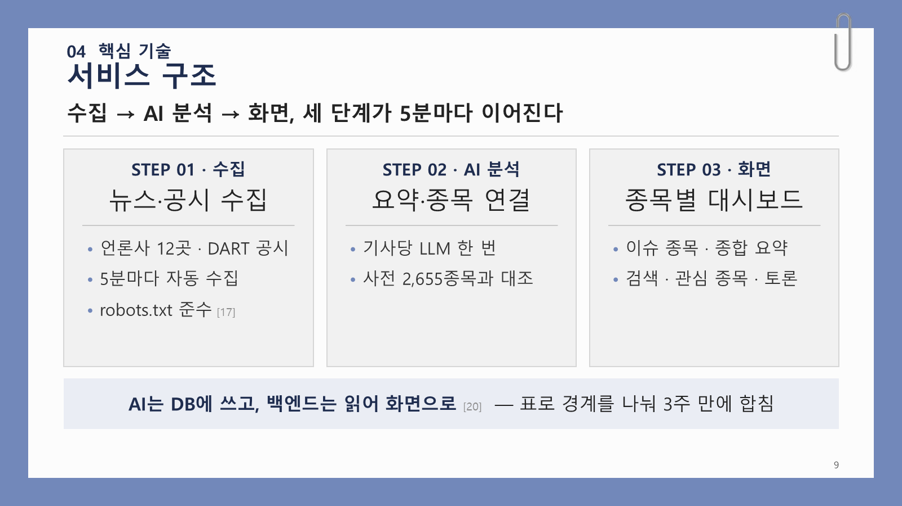
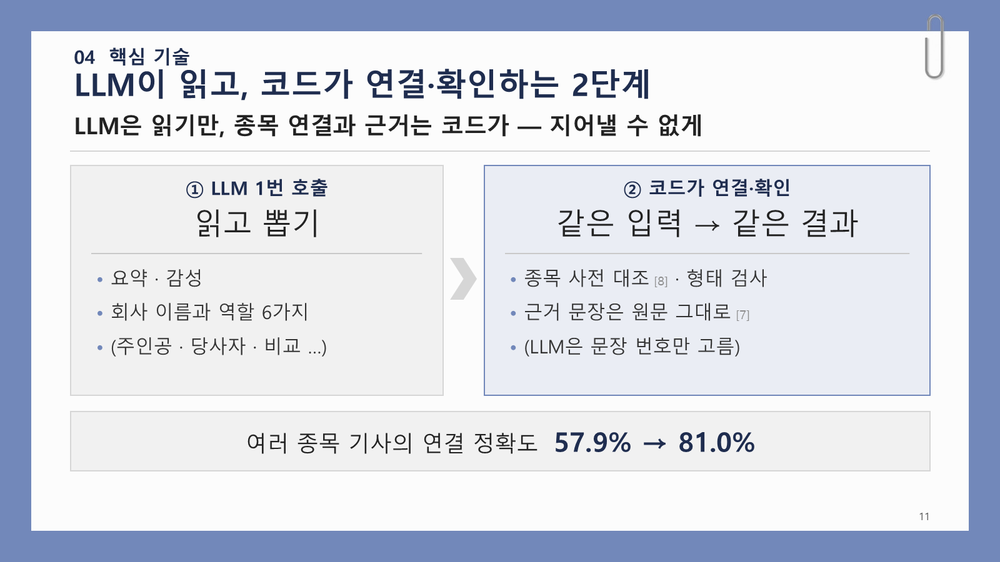
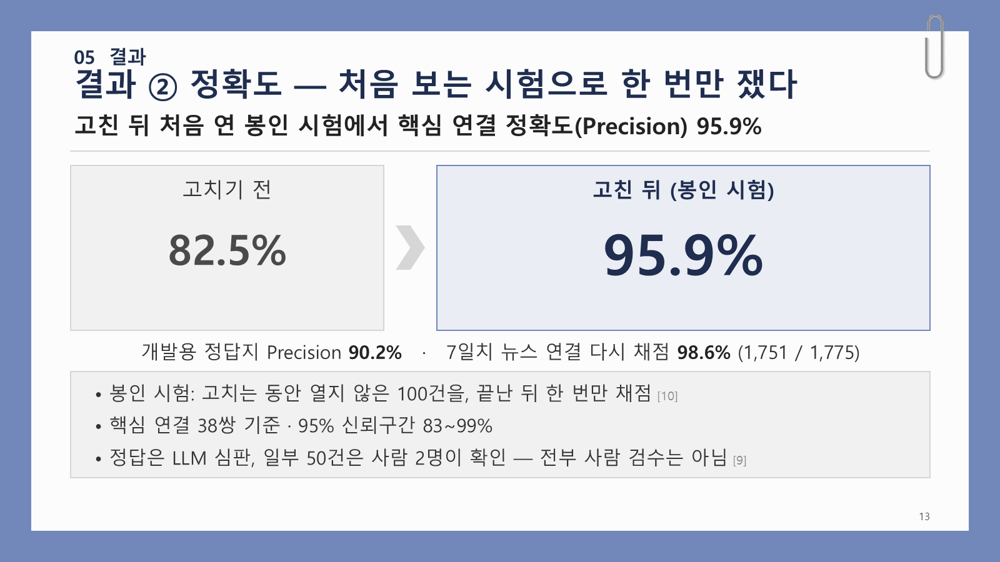

<div align="center">


# NewsTalk (뉴스톡) · Stocks Through the News

## A web service that shows which stocks a news article or corporate disclosure is about, why — and the exact source sentence that proves it

<br>

**TEAM 2** — `Team lead · AI: Seunghyun Ji` · `Backend 1 · GitHub: Taekyoung Kim` · `Backend 2: Hohyeon Lim` · `Frontend: Seojun Park`

Hankyung.com IT Education Center · K-Digital Training finance team project  |  Oct 28 – Nov 18, 2026 (3 weeks)

<br>


<br>

**🌐 Language:** [한국어](README.md) | **English**

</div>

> ### 👤 What Taekyoung Kim (Backend 1 · GitHub) did in this repository
>
> | | |
> |---|---|
> | **Role** | Backend 1 and GitHub owner — authored **101 of the team's 128** merged pull requests, about 420 non-merge commits |
> | **Backend** | The whole Spring Boot server skeleton and **database design (Flyway V1–V18, 20 tables)**; the screen APIs (article list/detail, trending-stock ranking, per-stock summary and sentiment, mention counts, unified search, data status); sign-up / login (JWT), watchlist, per-stock discussion board, account settings and category filters |
> | **Real-time quotes (extension)** | Korea Investment & Securities (KIS) Open API: current price, minute/daily candles, WebSocket trades re-broadcast over SSE, articles on big-move days (F-17), batched multi-stock quotes (home screen 1.6–2.1 s → about 0.27 s) |
> | **AI matching (after mentor feedback)** | Built the gold-set and sealed-test evaluation, and restructured matching so that "the LLM only reads; code links and verifies" — **core-link precision 82.5% → 95.9%** on the sealed test. Disclosure summaries and evidence sentences, same-story grouping, collector health checks and circuit breaker, daily LLM cost cap |
> | **Frontend** | The final UI (`frontend/src/ours/`: home, news, disclosures, stock, market map, watchlist, account, guide) and the "At a glance" pro mode |
> | **Ops & collaboration** | One-command Docker Compose run, GitHub Actions CI (automated tests on every PR), login-attempt limit and API rate limit, Git guide, API docs and decision log (`docs/decisions.md`) |
> | **Deliverables** | Requirements spec and traceability matrix, function spec, WBS, table spec and ERD, query tests, API spec, system architecture, integration tests (42/42), issue/risk log, final report and presentation |
>
> The AI pipeline stages 1–8 and the summary AI server (Seunghyun Ji), stock aliases/themes and frontend API wiring (Hohyeon Lim), and dashboard UI V1–V7 (Seojun Park, `frontend/src/pages/`) were built by teammates. The rest of this README follows the team presentation.

> 📑 This README **follows the structure of the final presentation ([`deliverables/발표PPT_2팀_뉴스톡(15분).pptx`](deliverables/))** — problem → solution → demo → technology → results → wrap-up — so that a first-time reader can understand the whole project. Slide images are in Korean. The full report with evidence, footnotes and appendices is [`deliverables/결과보고서_2팀_뉴스톡.pptx`](deliverables/) (Korean).

---

## 📋 Contents

| | Section | Topics |
|---|---|---|
| **01** | [The Problem](#01-the-problem) | Volume · Reason · Trust |
| **02** | [Our Solution](#02-our-solution) | What NewsTalk shows · How it differs |
| **03** | [Demo](#03-demo) | From one article to stocks and evidence |
| **04** | [Core Technology](#04-core-technology) | Architecture · Scale · Two-step LLM + code |
| **05** | [Results](#05-results) | Collection · Accuracy · Cost · How we improved |
| **06** | [Wrap-up](#06-wrap-up) | Impact and limits · Team and lessons |
| **+** | [References](#-references) | Same numbering as the report |
| **+** | [Backup: Measurement · Key Decisions](#-backup-measurement--key-decisions) | How numbers were measured · Why we chose what we chose |
| **+** | [Quick Start](#-quick-start) | How to run · Project layout · Docs |

---

# 01. The Problem

## 📚 Problem 1: Volume — nobody can read it all

> ### Over 1,200 articles pile up every weekday, but a person can only read so much

| Number | Meaning |
|---|---|
| **39.6%** | Top reason investors read fewer brokerage reports: "too much to read" (1,005 investors in their 30s–40s, 2026) [1] |
| **1,200+** | Articles per weekday from just 12 outlets (our own collection, Nov 12–18) |
| **about 31%** | Repeats of the same story after the first report — you end up reading the same news several times |

People who feel overloaded by news rose **11 percentage points** since 2019 [2], and Korea has **14.1 million** individual stock investors [3].



## ❓ Problem 2: Reason — buying without knowing why this stock

> ### Stock links without a reason — and individuals carry the loss

- Typical news screens show **an article plus stock tags** — no reason for the link and no way to check it.
- Of 60 "political theme" stocks reviewed by Korea's FSS and KRX in 2025, **72%** fell more than 30% from their peak, and **86.9%** of that trading was by individuals (vs. 66.6% market-wide) [4].
- Investors need not just a stock name, but **the reason for the link and the source evidence**.

## 🔍 Problem 3: Trust — AI summaries can be wrong, and you can't check

> ### Even if AI reads for you, you can't trust it without a checkable source

| Number | Meaning |
|---|---|
| **45%** | AI assistants' news answers (ChatGPT, Gemini and two others) with at least one significant issue — 22 public broadcasters in 18 countries [5] |
| **31%** | Of those, sourcing problems: missing or wrong sources |
| **15.6%** | Investors who already get stock information from AI (1,000 people aged 20–59) [1] |

Apple paused its AI news summaries after they produced false headlines [6]. Even large models make mistakes, so **source evidence you can check when it is wrong** is essential.

---

# 02. Our Solution

## 💡 What NewsTalk shows

> ### One article → related stocks → why they're linked → source evidence, on one screen

| # | Shown | Details |
|---|---|---|
| 1 | **Article** | 3-line AI summary · article tone |
| 2 | **Related stocks** | Only the main subject and directly involved companies |
| 3 | **Reason** | One line on why this stock |
| 4 | **Source evidence** | The article sentence as written, plus a link to the original |

NewsTalk leaves the judgment to the investor and shows only the facts and evidence in the article.



## 🆚 How it differs from similar services

> ### Services that summarize "why" already exist — NewsTalk lets you verify the why

Brokerage apps and portals already use AI to explain price moves. NewsTalk focuses on **verification and measurement**.

| Difference | Details |
|---|---|
| **A reason you can check** | Reason + the exact source sentence, one click to the original [7] |
| **Published accuracy** | Link accuracy measured on a sealed test [10]; features below the bar were dropped |
| **Same-story grouping** | Re-reported articles grouped as "n articles", with the first-reporting outlet marked [14] |
| **Judgment stays with the investor** | No "good news / bad news" verdicts [13]; positive · negative · neutral · undecided [15][16] |

---

# 03. Demo

## 🎬 Live demo

> ### From one article to stocks and evidence, on the real screens

| Step | Screen |
|---|---|
| 1 | Home: market map · most-covered stories today |
| 2 | Article detail: summary · reason · evidence |
| 3 | Stock: real-time price · overall summary · charts |
| 4 | News / disclosure lists · unified search |
| 5 | "At a glance" pro view |
| 6 | Sign-up · watchlist · discussion |



> To run it yourself, follow the [Quick Start](#-quick-start). Real-time quotes need your own KIS API key (without one, the screen shows "quotes not connected").

---

# 04. Core Technology

## 🏗 Service architecture

> ### Collect → AI analysis → screens, chained every 5 minutes

```
STEP 01 · Collect            STEP 02 · AI analysis          STEP 03 · Screens
News & disclosures    →      Summary & stock linking   →    Per-stock dashboard
12 outlets + DART filings    One LLM call per article       Trending stocks, summaries
Every 5 minutes              Checked against 2,655 stocks   Search, watchlist, board
Respects robots.txt [17]
```

The AI part writes to the database and the backend only reads it [20] — **the tables are the boundary**, so neither side calls the other's code, which let us integrate in three weeks.



## 📐 What we built — three parts, one service

> ### Spring Boot · React · Python as one service — 45 APIs · 20 tables

| Screen APIs | DB tables | Automated tests |
|:---:|:---:|:---:|
| **45** (REST 43 · SSE 2) | **20** (Flyway V1–V18) | **222 + 97** (backend + AI, CI on every PR) |

| Part | Technology | Key features |
|---|---|---|
| Backend | Java 21 · Spring Boot 4.1 [19] · JWT · MyBatis | Login lockout [21] · rate limiting · real-time quotes |
| AI | Python · LangChain · gpt-5.4-nano | 5-minute collection · summaries · stock linking |
| Frontend | React 19 · Vite · Lightweight Charts | Dashboard · charts · "At a glance" view |
| Collaboration | Docker Compose · GitHub Actions | One-command run · 128 PRs |

## 🧠 Two steps: the LLM reads, code links and verifies

> ### The LLM only reads; code does the linking and evidence — so nothing can be made up

| Step | What it does |
|---|---|
| **1. One LLM call — read and extract** | Summary and sentiment; company names with one of six roles (main subject, involved party, comparison, …) |
| **2. Code links and verifies — same input, same output** | Match against the stock dictionary [8] and shape checks; evidence sentences copied verbatim from the source [7] (the LLM only picks a sentence number) |

This structure raised **link accuracy on multi-stock articles from 57.9% to 81.0%**.



---

# 05. Results

## 📥 Result 1: Collection and analysis

> ### 24,877 items collected and 13,376 analyzed in three weeks

| Articles & disclosures collected | Analyzed by the LLM | Collection success rate |
|:---:|:---:|:---:|
| **24,877** | **13,376** | **98.2%** |
| News 17,088 · disclosures 7,789 (since Nov 3, as of Nov 19 1 p.m.) | News 5,733 · disclosures 7,643 (only items that mention a stock) | 1,960 of 1,995 runs (every 5 minutes) |

- ✓ We followed each source's terms and robots.txt, and never worked around a block [17]
- ✓ Article bodies are used only for summarizing and are deleted after 7 days (copyright)

## 🎯 Result 2: Accuracy — measured once, on a test we never looked at

> ### Core-link precision of 95.9% on a sealed test opened only after the fixes

| Before fixes | After fixes (sealed test) |
|:---:|:---:|
| 82.5% | **95.9%** |

Development gold set precision 90.2% · re-grading 7 days of news links: 98.6% (1,751 / 1,775)

- **Sealed test**: 100 articles kept closed during development and graded once at the end [10]
- Based on 38 core links · 95% confidence interval 83–99%
- Labels come from an LLM judge; 50 items were checked by two people — **not fully human-reviewed** [9]



## 💰 Result 3: Cost — a cheaper model, the same accuracy

> ### $0.0012 per article — about 1/100 of what a person reading the same amount would cost

| Per article | Per month | If a person read it all |
|:---:|:---:|:---:|
| **$0.0012** | **about ₩29,000** | about ₩2.88 million |
| Measured Nov 14–18: $3.442 ÷ 2,788 articles [12] | Within a ₩50,000 budget · daily cap of $2 | Same volume · 1 minute per article · ₩10,320/hour minimum wage [18] |

- The next model up, gpt-5.4-mini, had the same core F1 (90.2 = 90.2), so we chose **gpt-5.4-nano**, which is 2–3× cheaper [11][12]
- Only the first 3,000 characters of the body are sent — all 69 gold evidence sentences fell within that range

## 🔁 How we improved — from mentor feedback to measured fixes

> ### Take the feedback, measure it, and drop what doesn't meet the bar

```
1. Mentor feedback (8)   →   2. Measure              →   3. Apply (Nov 9)            →   4. Decide: drop below-bar
Multi-stock linking          Fix against a gold set      6 applied                       Indirect linking ~53%
Cost, verification, source   Grade the sealed test once  Undecided label, grouping…      SNS blogs 9.9%
```

Sealed test 82.5% → 95.9%  ·  Integration tests **42/42 pass**

---

# 06. Wrap-up

## 🌟 Impact and limits

> ### Investors see the evidence first and it runs cheaply — next up: a collection server and more human review

| Impact — who uses it, and how | Limits and next steps |
|---|---|
| Investors: check the evidence instead of reading every article | Move the collector from a personal PC to the cloud |
| Industry: brokerage news tabs · research / IR monitoring | From LLM-judge estimates to more human review |
| Operations: about ₩29,000 a month | Commercial use requires agreements with news publishers (this is a non-profit educational project quoting one sentence per article) |

Judgment stays with the investor — facts and evidence only, no buy or sell recommendations [15][16].

## 👥 Team and lessons

> ### Four people merged 128 PRs in three weeks and kept it working end to end

| Name | Role | Responsibilities |
|---|---|---|
| Seunghyun Ji | Team lead · AI | Meetings, requirements integration (F-01 to F-21), AI pipeline stages 1–8 (collection, summaries, stock linking, same-story grouping, overall summary), summary AI server |
| **Taekyoung Kim** | **Backend 1 · GitHub** | **DB design and APIs, login / watchlist / board, real-time quotes, AI matching and gold-set evaluation after mentor feedback, CI and Docker, deliverables** |
| Hohyeon Lim | Backend 2 | Stock aliases, themes and groups (shared), frontend API wiring: stock search, price chart, mention counts, top-7 trending, board |
| Seojun Park | Frontend | Dashboard UI (V1–V7): layout and sidebar, sentiment filter, dark/light theme, detail-screen UX |

**Lesson** — choosing with evidence and measurement matters more than just making a feature work.

---

## 📖 References

Same numbering as the presentation and the final report.

| # | Source |
|---|---|
| [1] | Seoul Shinmun (2026). Remember Research and PMI investor surveys |
| [2] | Reuters Institute (2024). Digital News Report |
| [3] | Korea Securities Depository (2025). 2024 year-end shareholder statistics |
| [4] | Etoday (2025-05-14). Report on the FSS–KRX political theme stock meeting |
| [5] | EBU · BBC (2025). News Integrity in AI Assistants |
| [6] | Reports on Apple pausing AI news summaries (2025-01) |
| [7] | Maynez et al. (2020). On Faithfulness and Factuality in Abstractive Summarization. ACL |
| [8] | Shen et al. (2015). Entity Linking with a Knowledge Base. TKDE |
| [9] | Zheng et al. (2023). Judging LLM-as-a-Judge. NeurIPS |
| [10] | Cawley, Talbot (2010). On Over-fitting in Model Selection and Subsequent Selection Bias. JMLR |
| [11] | Chen, Zaharia, Zou (2023). FrugalGPT. arXiv |
| [12] | OpenAI. API Pricing |
| [13] | MacKinlay (1997). Event Studies in Economics and Finance. JEL |
| [14] | RavenPack. News analytics: relevance · event novelty |
| [15] | Financial Services Commission (2026). AI Guidelines for the Financial Sector |
| [16] | Financial Investment Services and Capital Markets Act §6 · §7 · §101 |
| [17] | IETF RFC 9309 (2022). Robots Exclusion Protocol |
| [18] | Minimum Wage Commission. 2026 minimum wage ₩10,320 |
| [19] | endoflife.date — Spring Boot support periods |
| [20] | Fowler, M. Integration Database |
| [21] | OWASP. Authentication Cheat Sheet |

Our own measurements and decisions: [`docs/decisions.md`](docs/decisions.md) (Korean) · report appendices

---

## 🧪 Backup: Measurement · Key Decisions

<details>
<summary><b>How the accuracy and cost numbers were measured</b></summary>

| Number | How it was measured |
|---|---|
| Development gold set P 90.2% | 100 articles labeled with "which stocks should this link to" per a written guideline, compared with the system output (recall 85.6%) |
| Sealed test P 95.9% | 100 test articles never opened during development, graded once on Nov 6. Average of 3 runs over 38 core links (95% interval 83–99%) — 82.5% before the fixes |
| Core link | Only the article's main subject and involved companies are graded; passing mentions are excluded |
| 7-day re-grade 98.6% | On Nov 16, an LLM judge re-checked 1,775 links from 7 days of news; 1,751 were correct (5 undecidable excluded) |
| Human check | A later v2 gold set of 50 articles was labeled independently by two people → human-to-human F1 95.7 |
| Cost $0.0012 | Actual API spend Nov 14–18, $3.442 ÷ 2,788 analyzed items |

</details>

<details>
<summary><b>Key decisions and the alternatives we considered</b></summary>

| Decision | Alternative | Why |
|---|---|---|
| Spring Boot 4.1 | Spring Boot 3.5 | Free support for 3.5 ends on 2026-06-30 |
| MyBatis | JPA | Many aggregate queries, so we wanted direct control of SQL |
| AI writes tables, backend reads them | Services calling each other's APIs | Tables as the boundary; no cross-calls between codebases |
| LLM only reads; code links | LLM outputs stock codes directly | Shorter, cheaper prompts and no risk of invented codes |
| gpt-5.4-nano | gpt-5.4-mini | Same core F1 (90.2) at 1/2–1/3 the cost |
| Indirect links and SNS left out of v1 | Include them with a label | Indirect precision about 53%, blog pass rate 9.9% |

The full decision log (date · decision · reason · alternatives) is in [`docs/decisions.md`](docs/decisions.md) (Korean).

</details>

---

# 🚀 Quick Start

All you need is Docker Desktop. Detailed setup and troubleshooting: [`docs/setup.md`](docs/setup.md) (Korean).

```bash
# 1. Clone
git clone https://github.com/MoriochoRadio/newstalk.git
cd newstalk

# 2. Create your settings (copy .env.example and fill in DB account, JWT_SECRET, etc.)
cp .env.example .env

# 3. Start DB + backend (the collected AI data loads automatically)
docker compose up -d --build

# 4. Everything including the UI (→ http://localhost:5173)
docker compose --profile full up -d --build
```

| URL | What you see |
|---|---|
| http://localhost:5173 | NewsTalk UI (`--profile full`) |
| http://localhost:8080/swagger-ui.html | API list (Swagger) |

- Automatic AI collection (`--profile ai`) needs an OpenAI key and costs money. Real-time quotes need your own KIS key and `KIS_ENABLED=true` ([setup.md](docs/setup.md) section 13).
- Secrets (`.env`), KIS quote data and article bodies are never committed ([AGENTS.md](AGENTS.md)).

## 📂 Project layout

```
newstalk/
├── backend/          Spring Boot server — stock dictionary, members/watchlist/board, screen APIs, real-time quotes
│   └── src/main/resources/db/migration/   Flyway V1–V18 (20 tables)
├── ai/               Python — news & disclosure collection, LLM summaries, stock linking, same-story grouping, summary server
│   └── eval/         Gold set and sealed-test evaluation
├── frontend/         React 19 + Vite
│   ├── src/ours/     Final UI (home, news, disclosures, stock, market map, watchlist, account)
│   └── src/pages/    Dashboard V1–V7 (earlier UI)
├── docs/             API (api.md) · DB (db/schema.md) · decision log (decisions.md) · setup (setup.md)
│   └── presentation/ Presentation slide images
├── deliverables/     Presentation and final report (PPTX)
└── docker-compose.yml
```

## 📚 More docs (Korean)

| Document | Contents |
|---|---|
| [`docs/api.md`](docs/api.md) | API spec (requests, responses, error codes) |
| [`docs/db/schema.md`](docs/db/schema.md) | Table design |
| [`docs/decisions.md`](docs/decisions.md) | Decision log — date · decision · reason · alternatives |
| [`docs/setup.md`](docs/setup.md) | Development setup and running |
| [`docs/README-team.md`](docs/README-team.md) | The original team README |
| [`ai/README.md`](ai/README.md) | AI pipeline, step by step |

> Original team repository: [hk-finance-team2/stock-news-matching](https://github.com/hk-finance-team2/stock-news-matching) — this repository carries its full `main` history plus a portfolio README.
