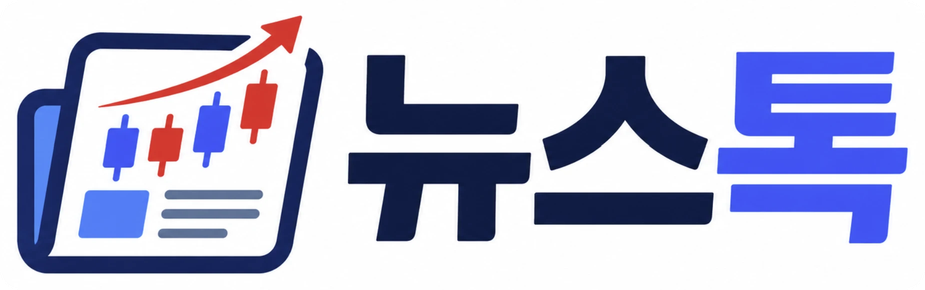

# 뉴스톡 (stock-news-matching)

뉴스·공시가 **어떤 종목에, 왜** 영향을 주는지 AI로 분석해 요약과 함께 보여주는 웹 서비스 · 뉴스로 보는 종목

한경닷컴 IT교육센터 금융 팀프로젝트 (2026)

> **V1 프로토타입 (2026-11-10):** 처음 보는 분은 **[docs/v1-prototype.md](docs/v1-prototype.md)** 에서 켜는 법과 데이터 흐름(수집 → AI → DB → API → 화면)을 따라가 보세요. 1차에서는 SNS를 빼고 뉴스·공시만 다룹니다.

## 1차 범위 (발표 2026-11-20)

| 구분 | 내용 | 켜는 법 |
|---|---|---|
| **1차 서비스** | 뉴스 RSS 7곳 + DART 공시 수집 → AI 요약·종목 연결·근거 문장 → 같은 소식 묶기 → 이슈 종목·종목별 요약·검색·관심 종목·토론 | 기본으로 켜짐 |
| 확장: 실시간 시세 | KIS 현재가·차트·실시간 체결 (`backend/.../quote`) | `KIS_ENABLED=true` + 각자 KIS 키 ([setup.md](docs/setup.md) 13절). 꺼져 있으면 화면에 "시세 연동 전" |
| 확장: SNS | 네이버 블로그·카페 (`ai/hk_llm/steps/sns.py`) | `SNS_ENABLED=true`. 1차에서 뺀 이유는 [decisions.md](docs/decisions.md) 2026-11-09 |
| 실험만 | 이름 없는 간접 연결(유가 급등 → 정유주, `step6b_indirect.py`) | 자동 실행에 연결 안 됨. Precision 16.7% 라 뺌 |

## 구조

| 폴더 | 내용 |
|---|---|
| `backend/` | Spring Boot 서버 (종목 사전, 회원·관심 종목·게시판, 화면용 API) |
| `ai/` | 뉴스·SNS 수집, 종목 매칭, LLM 요약 |
| `frontend/` | 사용자 대시보드 |
| `docs/` | 설치·실행 방법, API 목록, DB 설계, 결정 기록 |

## 시작하기

1. 처음이라면 **[Git 사용 가이드](docs/git-guide.md)**를 순서대로 따라 하세요. 레포 내려받기부터 PR 올리기까지 들어 있습니다.
2. 내 PC에서 DB와 백엔드를 켜려면 **[개발 환경 설정](docs/setup.md)**을 보세요. Docker만 있으면 명령 한 줄로 켜집니다.
3. 문서 전체 안내는 **[docs/README.md](docs/README.md)**에 있습니다.

팀 규칙은 [AGENTS.md](AGENTS.md)에 있습니다.

## AI 에이전트

팀 규칙은 [AGENTS.md](AGENTS.md) 한 곳에 있습니다.

| 도구 | 읽는 파일 |
|---|---|
| Codex, Antigravity(1.20.5 이상), Cursor, GitHub Copilot 등 | `AGENTS.md` (자동) |
| Claude Code | `CLAUDE.md` → `AGENTS.md`를 불러옴 |

규칙을 바꿀 때는 `AGENTS.md`만 고치면 됩니다.
