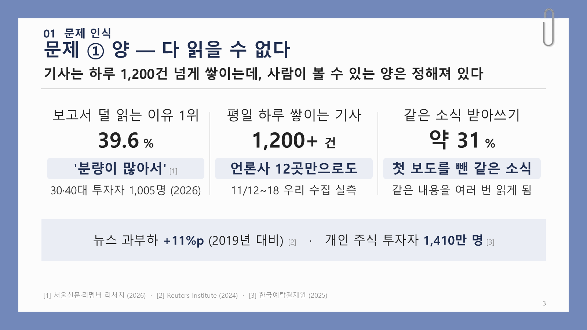
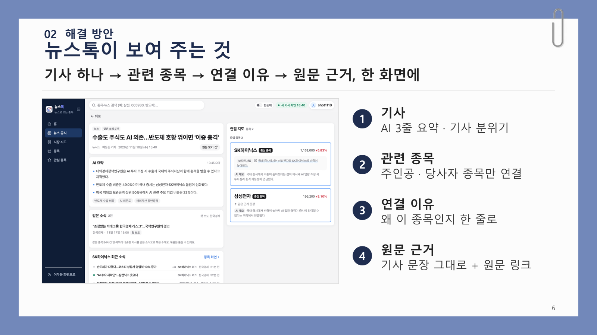
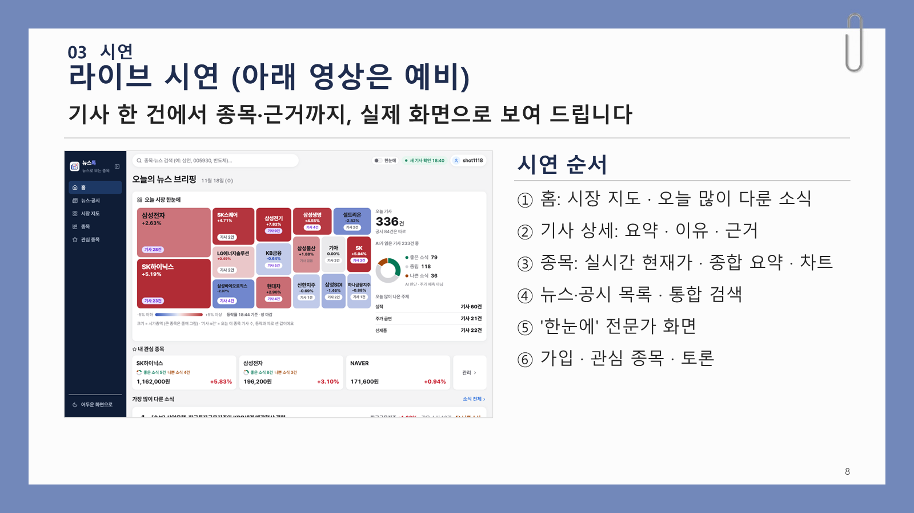
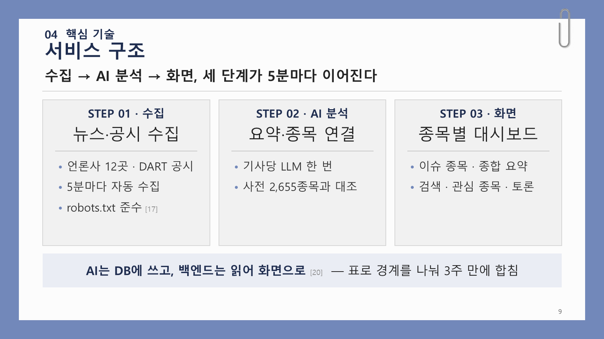
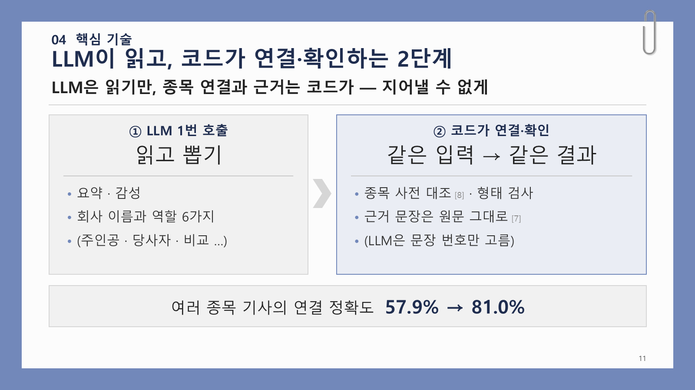
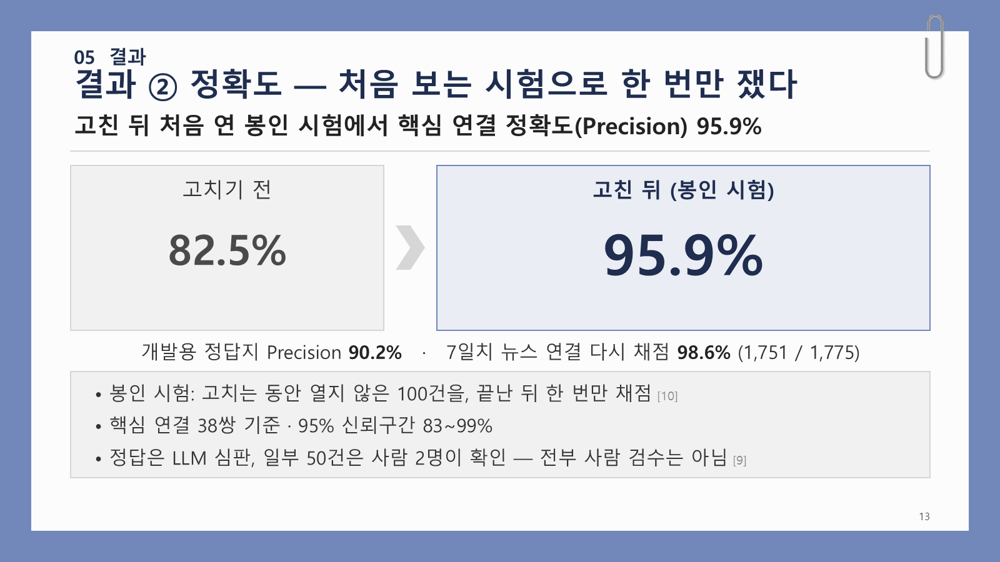

<div align="center">


# 뉴스톡 · 뉴스로 보는 종목

## 뉴스·공시가 어떤 종목에, 왜 언급되는지 — 원문 근거 문장과 함께 보여 주는 웹 서비스

<br>

**TEAM 2팀** — `팀장·AI 지승현` · `백엔드1·GitHub 김태경` · `백엔드2 임호현` · `프론트엔드 박서준`

㈜한경닷컴 IT교육센터 · K-Digital Training 금융 팀 프로젝트  |  2026. 10. 28 ~ 11. 18 (3주)

<br>


</div>

> ### 👤 이 레포에서 김태경(백엔드1 · GitHub)이 한 일
>
> | | |
> |---|---|
> | **역할** | 백엔드1 · GitHub 관리 — 팀 전체 PR 128개 중 **101개**, 커밋(merge 제외) 약 420개 |
> | **백엔드** | Spring Boot 서버 전체 골격과 **DB 설계(Flyway V1~V18, 테이블 20개)**, 화면용 API(글 목록·상세, 이슈 순위, 종목 종합 요약·감성, 언급량, 통합 검색, 데이터 상태), 회원가입·로그인(JWT)·관심 종목·종목 토론 게시판, 내 계정·분류별 보기 |
> | **실시간 시세 (확장)** | 한국투자증권(KIS) 현재가·분봉·일봉 조회, 웹소켓 체결 → SSE 방송, 급등·급락한 날의 기사(F-17), 여러 종목 현재가 한 번에 조회(홈 1.6~2.1초 → 약 0.27초) |
> | **AI 매칭 (멘토 피드백 후)** | 정답지·봉인 시험 평가 체계를 만들고, "LLM은 읽기만, 연결·근거는 코드가" 구조로 고쳐 **핵심 연결 정확도 82.5% → 95.9%**(봉인 시험). 공시 요약·근거 문장, 같은 소식 묶기, 수집 점검·차단기, LLM 하루 비용 상한 |
> | **화면** | 최종 화면(`frontend/src/ours/`: 홈·뉴스·공시·종목·시장 지도·관심 종목·내 계정·이용 안내)과 '한눈에' 전문가 모드 |
> | **운영·협업** | Docker Compose 한 줄 실행, GitHub Actions CI(PR마다 자동 테스트), 로그인 시도 제한·API 호출 수 제한, Git 가이드·API 문서·결정 기록(`docs/decisions.md`) |
> | **산출물** | 요구사항 명세서·추적표, 기능정의서, WBS, 테이블정의서·ERD, 쿼리 테스트, API 명세서, System Architecture, 통합 테스트(42/42), 이슈·리스크 대장, 결과보고서·발표 PPT |
>
> AI 파이프라인 1~8단계 설계·구현과 종합 요약 AI 서버(지승현), 종목 별칭·테마 정리와 프론트 API 연동(임호현), 대시보드 UI V1~V7(박서준, `frontend/src/pages/`)은 팀원 담당입니다. 아래는 팀 발표 구성 그대로입니다.

> 📑 이 README는 **발표 자료([`deliverables/발표PPT_2팀_뉴스톡(15분).pptx`](deliverables/))를 그대로 옮긴 구성**입니다.
> 발표 흐름(문제 → 해결 → 시연 → 기술 → 결과 → 마무리)을 따라 처음 보는 분도 프로젝트 전체를 이해할 수 있게 썼습니다. 근거·각주·부록까지 담은 결과보고서는 [`deliverables/결과보고서_2팀_뉴스톡.pptx`](deliverables/)에 있습니다.

---

## 📋 목차

| | 장 | 내용 |
|---|---|---|
| **01** | [문제 인식](#01-문제-인식) | 양 · 이유 · 신뢰 |
| **02** | [해결 방안](#02-해결-방안) | 뉴스톡이 보여 주는 것 · 비슷한 서비스와 다른 점 |
| **03** | [시연](#03-시연) | 기사 한 건에서 종목 · 근거까지 |
| **04** | [핵심 기술](#04-핵심-기술) | 서비스 구조 · 규모 · LLM과 코드 2단계 |
| **05** | [결과](#05-결과) | 수집 · 정확도 · 비용 · 개선 과정 |
| **06** | [마무리](#06-마무리) | 기대 효과와 한계 · 팀과 배운 점 |
| **+** | [참고자료](#-참고자료) | 결과보고서와 같은 번호 |
| **+** | [예비: 측정 방법 · 주요 결정](#-예비-측정-방법--주요-결정) | 숫자를 잰 방법 · 기술 선택 이유 |
| **+** | [Quick Start](#-quick-start) | 실행 방법 · 프로젝트 구조 · 문서 |

---

# 01. 문제 인식

## 📚 문제 ① 양 — 다 읽을 수 없다

> ### 기사는 하루 1,200건 넘게 쌓이는데, 사람이 볼 수 있는 양은 정해져 있다

| 숫자 | 뜻 |
|---|---|
| **39.6%** | 투자자가 증권사 보고서를 덜 읽는 이유 1위 '분량이 많아서' (30·40대 투자자 1,005명, 2026) [1] |
| **1,200+ 건** | 평일 하루 쌓이는 기사 — 언론사 12곳만으로도 (11/12~18 우리 수집 실측) |
| **약 31%** | 첫 보도를 뺀 같은 소식(받아쓰기) — 같은 내용을 여러 번 읽게 됨 |

뉴스 양에 과부하를 느끼는 사람은 2019년보다 **11%p** 늘었고 [2], 개인 주식 투자자는 **1,410만 명**입니다 [3].



## ❓ 문제 ② 이유 — 왜 이 종목인지 모른 채 산다

> ### 이유 없이 붙은 종목 연결, 그 손실은 개인이 떠안는다

- 지금 흔한 뉴스 화면은 **기사 + 종목 태그**뿐 — 연결 이유가 없고, 맞는 연결인지 확인할 수 없습니다.
- 2025년 금감원·한국거래소가 본 정치테마주 60종목 중 **72%**가 고점 대비 30% 넘게 하락, 그 매매의 **86.9%**가 개인(시장 전체 66.6%) [4].
- 종목 이름만이 아니라 **연결 이유와 원문 근거**가 함께 필요합니다.

## 🔍 문제 ③ 신뢰 — AI 요약은 틀려도 확인할 수 없다

> ### AI가 대신 읽어 줘도, 출처를 확인할 수 없으면 믿을 수 없다

| 숫자 | 뜻 |
|---|---|
| **45%** | AI 비서(ChatGPT·Gemini 등 4종)의 뉴스 답변 중 중대한 문제가 1개 이상 (공영방송 22곳·18개국) [5] |
| **31%** | 그중 출처 문제 — 출처 없음 · 잘못된 출처 |
| **15.6%** | 주식 정보를 이미 AI에서 얻는 투자자 (20~59세 1,000명) [1] |

Apple도 AI 뉴스 요약이 가짜 헤드라인을 만들어 기능을 멈췄습니다 [6]. 큰 모델도 틀릴 수 있으니, **틀렸을 때 확인할 수 있는 원문 근거**가 필요합니다.

---

# 02. 해결 방안

## 💡 뉴스톡이 보여 주는 것

> ### 기사 하나 → 관련 종목 → 연결 이유 → 원문 근거, 한 화면에

| # | 보여 주는 것 | 내용 |
|---|---|---|
| 1 | **기사** | AI 3줄 요약 · 기사 분위기 |
| 2 | **관련 종목** | 주인공 · 당사자 종목만 연결 |
| 3 | **연결 이유** | 왜 이 종목인지 한 줄로 |
| 4 | **원문 근거** | 기사 문장 그대로 + 원문 링크 |

판단은 투자자에게 맡기고, 뉴스톡은 기사에 적힌 사실과 근거만 보여 줍니다.



## 🆚 비슷한 서비스와 다른 점

> ### 이유를 요약하는 서비스는 이미 있다 — 뉴스톡은 그 이유를 확인할 수 있게

증권사 앱·포털도 AI로 주가 변동 이유를 설명합니다. 뉴스톡은 **확인과 측정**에 집중했습니다.

| 다른 점 | 내용 |
|---|---|
| **확인할 수 있는 이유** | 이유 + 기사 원문 문장 그대로, 원문 링크로 바로 확인 [7] |
| **얼마나 맞는지 공개** | 봉인 시험으로 잰 연결 정확도 [10], 기준 미달 기능은 뺌 |
| **같은 소식 묶기** | 받아쓴 기사는 'n건'으로 묶고 첫 보도 언론사를 표시 [14] |
| **판단은 투자자에게** | 호재·악재로 단정하지 않음 [13], 긍정·부정·중립·판단 보류 [15][16] |

---

# 03. 시연

## 🎬 라이브 시연

> ### 기사 한 건에서 종목·근거까지, 실제 화면으로

| 순서 | 화면 |
|---|---|
| ① | 홈: 시장 지도 · 오늘 많이 다룬 소식 |
| ② | 기사 상세: 요약 · 이유 · 근거 |
| ③ | 종목: 실시간 현재가 · 종합 요약 · 차트 |
| ④ | 뉴스·공시 목록 · 통합 검색 |
| ⑤ | '한눈에' 전문가 화면 |
| ⑥ | 가입 · 관심 종목 · 토론 |



> 직접 켜 보려면 아래 [Quick Start](#-quick-start)를 따라 하세요. 실시간 시세는 각자 KIS 키가 있어야 켜집니다(없으면 화면에 "시세 연동 전").

---

# 04. 핵심 기술

## 🏗 서비스 구조

> ### 수집 → AI 분석 → 화면, 세 단계가 5분마다 이어진다

```
STEP 01 · 수집            STEP 02 · AI 분석            STEP 03 · 화면
뉴스·공시 수집      →      요약·종목 연결       →       종목별 대시보드
언론사 12곳·DART 공시      기사당 LLM 한 번              이슈 종목·종합 요약
5분마다 자동 수집           사전 2,655종목과 대조          검색·관심 종목·토론
robots.txt 준수 [17]
```

AI는 DB에 쓰고, 백엔드는 읽어 화면으로 [20] — **표로 경계를 나눠** 서로의 코드를 부르지 않고 3주 만에 합쳤습니다.



## 📐 만든 것의 규모 — 세 파트를 한 서비스로

> ### Spring Boot · React · Python을 한 서비스로 — API 45개 · 테이블 20개

| 화면용 API | DB 테이블 | 자동 테스트 |
|:---:|:---:|:---:|
| **45개** (REST 43 · SSE 2) | **20개** (Flyway V1~V18) | **222 + 97** (백엔드 + AI, PR마다 CI) |

| 파트 | 기술 | 핵심 구현 |
|---|---|---|
| 백엔드 | Java 21 · Spring Boot 4.1 [19] · JWT · MyBatis | 로그인 잠금 [21] · 호출 제한 · 실시간 시세 |
| AI | Python · LangChain · gpt-5.4-nano | 5분 수집 · 요약 · 종목 연결 |
| 화면 | React 19 · Vite · Lightweight Charts | 대시보드 · 차트 · '한눈에' 화면 |
| 협업 | Docker Compose · GitHub Actions | 명령 한 줄 실행 · PR 128개 |

## 🧠 LLM이 읽고, 코드가 연결·확인하는 2단계

> ### LLM은 읽기만, 종목 연결과 근거는 코드가 — 지어낼 수 없게

| 단계 | 하는 일 |
|---|---|
| **① LLM 1번 호출 — 읽고 뽑기** | 요약 · 감성, 회사 이름과 역할 6가지(주인공 · 당사자 · 비교 …) |
| **② 코드가 연결·확인 — 같은 입력 → 같은 결과** | 종목 사전 대조 [8] · 형태 검사, 근거 문장은 원문 그대로 [7] (LLM은 문장 번호만 고름) |

이 구조로 **여러 종목이 나오는 기사의 연결 정확도가 57.9% → 81.0%**로 올랐습니다.



---

# 05. 결과

## 📥 결과 ① 수집과 분석

> ### 3주 동안 24,877건을 모아 13,376건을 분석했다

| 수집한 기사·공시 | LLM으로 분석한 글 | 수집 성공률 |
|:---:|:---:|:---:|
| **24,877건** | **13,376건** | **98.2%** |
| 뉴스 17,088 · 공시 7,789 (11/03부터, 11/19 13시 기준) | 뉴스 5,733 · 공시 7,643 (종목이 나온 글만) | 실행 1,995회 중 1,960회 (5분마다) |

- ✓ 약관과 robots.txt를 지키고, 막혀도 우회하지 않았습니다 [17]
- ✓ 본문은 요약에만 쓰고, 7일 뒤 지웁니다 (저작권)

## 🎯 결과 ② 정확도 — 처음 보는 시험으로 한 번만 쟀다

> ### 고친 뒤 처음 연 봉인 시험에서 핵심 연결 정확도(Precision) 95.9%

| 고치기 전 | 고친 뒤 (봉인 시험) |
|:---:|:---:|
| 82.5% | **95.9%** |

개발용 정답지 Precision 90.2% · 7일치 뉴스 연결 다시 채점 98.6% (1,751 / 1,775)

- **봉인 시험**: 고치는 동안 열지 않은 100건을 끝난 뒤 한 번만 채점 [10]
- 핵심 연결 38쌍 기준 · 95% 신뢰구간 83~99%
- 정답은 LLM 심판, 일부 50건은 사람 2명이 확인 — **전부 사람 검수는 아님** [9]



## 💰 결과 ③ 비용 — 싼 모델로 같은 정확도

> ### 기사 1건 $0.0012 — 같은 양을 사람이 읽는 비용의 약 100분의 1

| 기사 1건 분석 | 한 달 운영 | 사람이 읽으면 |
|:---:|:---:|:---:|
| **$0.0012** | **약 2.9만 원** | 약 288만 원 |
| 11/14~18 실측 $3.442 ÷ 2,788건 [12] | 예산 5만 원 안 · 하루 상한 $2 | 같은 양 · 1건 1분 · 시간급 10,320원 [18] |

- 한 단계 비싼 gpt-5.4-mini와 핵심 F1이 같아(90.2 = 90.2), 2~3배 싼 **gpt-5.4-nano**를 골랐습니다 [11][12]
- 본문은 앞 3,000자만 넣습니다 — 정답 근거 문장 69개가 모두 그 안에 있었습니다

## 🔁 개선 과정 — 멘토 지적에서 시작해 숫자로 고쳤다

> ### 지적을 받고, 숫자로 재고, 기준에 못 미친 것은 뺐다

```
① 멘토 지적 8가지   →   ② 측정: 숫자로 재기      →   ③ 반영 (11/09)        →   ④ 결정: 기준 미달 제외
여러 종목 연결          정답지로 고치고              6개 적용                    간접 연결 약 53%
비용·검증·근거           봉인 시험 한 번만             판단 보류·같은 소식 묶기 등    SNS 블로그 9.9%
```

봉인 시험 82.5% → 95.9%  ·  통합 테스트 **42/42 Pass**

---

# 06. 마무리

## 🌟 기대 효과와 한계

> ### 투자자는 근거부터 보고 운영은 싸게 — 남은 과제는 수집 서버와 사람 검수

| 기대 효과 — 누가, 어떻게 쓰나 | 한계와 다음 단계 |
|---|---|
| 투자자: 기사 대신 근거부터 확인 | 수집기 개인 PC → 클라우드로 |
| 실무: 증권사 뉴스 탭 · 리서치·IR 모니터링 | LLM 심판 추정 → 사람 검수 확대 |
| 운영: 한 달 약 2.9만 원 | 상용화는 언론사 계약이 전제 (지금은 비영리 교육용, 기사 한 문장 인용 범위) |

판단은 투자자에게 — 매수·매도 권유 없이 사실과 근거만 보여 줍니다 [15][16].

## 👥 팀과 배운 점

> ### 4명이 3주 동안 PR 128개를 합쳐 끝까지 동작하게 만들었다

| 이름 | 역할 | 담당 업무 |
|---|---|---|
| 지승현 | 팀장 · AI | 회의 진행, 요구사항 통합(F-01~F-21), AI 파이프라인 1~8단계(수집·요약·종목 연결·같은 소식·종합 요약), 종합 요약 AI 서버 |
| **김태경** | **백엔드1 · GitHub** | **DB 설계·API, 로그인·관심 종목·게시판, 실시간 시세, 멘토 피드백 후 AI 매칭·정답지 평가, CI·Docker, 산출물** |
| 임호현 | 백엔드2 | 종목 별칭·테마·그룹 정리(공동), 프론트 API 연동: 종목 검색·시세 차트·언급량·이슈 TOP 7·게시판 |
| 박서준 | 프론트엔드 | 대시보드 UI(V1~V7): 레이아웃·사이드바, 감성 필터, 다크/라이트 테마, 상세 화면 UX |

**배운 점** — 기능을 '되게 하는 것'보다, 근거를 갖고 숫자로 재서 '고르는 것'.

---

## 📖 참고자료

발표·결과보고서와 같은 번호입니다.

| # | 출처 |
|---|---|
| [1] | 서울신문 (2026). 리멤버 리서치·피앰아이 투자자 설문 |
| [2] | Reuters Institute (2024). Digital News Report |
| [3] | 한국예탁결제원 (2025). 2024년 결산 주식 소유자 현황 |
| [4] | 이투데이 (2025-05-14). 금감원·거래소 정치테마주 실무회의 보도 |
| [5] | EBU·BBC (2025). News Integrity in AI Assistants |
| [6] | Apple AI 뉴스 요약 중단 보도 (2025-01) |
| [7] | Maynez et al. (2020). On Faithfulness and Factuality in Abstractive Summarization. ACL |
| [8] | Shen et al. (2015). Entity Linking with a Knowledge Base. TKDE |
| [9] | Zheng et al. (2023). Judging LLM-as-a-Judge. NeurIPS |
| [10] | Cawley, Talbot (2010). On Over-fitting in Model Selection and Subsequent Selection Bias. JMLR |
| [11] | Chen, Zaharia, Zou (2023). FrugalGPT. arXiv |
| [12] | OpenAI. API Pricing |
| [13] | MacKinlay (1997). Event Studies in Economics and Finance. JEL |
| [14] | RavenPack. News analytics: relevance · event novelty |
| [15] | 금융위원회 (2026). 금융분야 AI 가이드라인 |
| [16] | 자본시장법 §6 · §7 · §101 |
| [17] | IETF RFC 9309 (2022). Robots Exclusion Protocol |
| [18] | 최저임금위원회. 2026년 최저임금 10,320원 |
| [19] | endoflife.date — Spring Boot 지원 기간 |
| [20] | Fowler, M. Integration Database |
| [21] | OWASP. Authentication Cheat Sheet |

우리 측정·결정 기록: [`docs/decisions.md`](docs/decisions.md) · 결과보고서 부록

---

## 🧪 예비: 측정 방법 · 주요 결정

<details>
<summary><b>측정 방법 — 정확도·비용 숫자를 이렇게 쟀다</b></summary>

| 숫자 | 잰 방법 |
|---|---|
| 개발용 정답지 P 90.2% | 기사 100건에 '어떤 종목과 연결돼야 하는가'를 기준서대로 달아 두고 시스템 답과 비교 (Recall 85.6%) |
| 봉인 시험 P 95.9% | 시험용 100건은 개선하는 동안 열지 않고 11/06에 한 번만 채점. 핵심 연결 38쌍 3번 평균 (95% 구간 83~99%) — 고치기 전 82.5% |
| 핵심 연결 | 기사의 주인공·당사자 종목만 채점, 이름만 지나가는 종목은 뺌 |
| 7일 재채점 98.6% | 11/16, 7일치 뉴스 연결 1,775개를 LLM 심판이 다시 판정해 1,751개가 맞음 (판단 불가 5개 제외) |
| 사람 확인 | 나중에 만든 v2 정답지 50건은 사람 2명이 따로 라벨 → 사람끼리 F1 95.7 |
| 비용 $0.0012 | 11/14~18 실제 사용 요금 $3.442 ÷ 분석한 글 2,788건 |

</details>

<details>
<summary><b>주요 결정과 검토한 대안</b></summary>

| 결정 | 검토한 대안 | 고른 이유 |
|---|---|---|
| Spring Boot 4.1 | Spring Boot 3.5 | 3.5 무료 지원 2026-06-30 종료 |
| MyBatis | JPA | 집계 SQL이 많아 SQL을 직접 다룸 |
| AI가 쓰고 백엔드는 읽는 표 | 서로 API 호출 | 표로 경계를 나눠 서로의 코드를 부르지 않음 |
| LLM은 읽기만, 연결은 코드 | LLM이 종목코드까지 | 짧고 싸며 코드를 지어낼 위험 없음 |
| gpt-5.4-nano | gpt-5.4-mini | 핵심 F1이 같고(90.2) 비용은 1/2~1/3 |
| 간접 연결 · SNS 1차 제외 | 넣고 표시 | 간접 Precision 약 53%, 블로그 통과 9.9% |

전체 결정 기록(날짜 · 결정 · 이유 · 검토한 대안)은 [`docs/decisions.md`](docs/decisions.md)에 있습니다.

</details>

---

# 🚀 Quick Start

Docker Desktop만 있으면 됩니다. 자세한 설치·문제 해결은 [`docs/setup.md`](docs/setup.md).

```bash
# 1. 레포 내려받기
git clone https://github.com/MoriochoRadio/newstalk.git
cd newstalk

# 2. 설정 파일 만들기 (.env.example 을 복사해 값 채우기 — DB 계정, JWT_SECRET 등)
cp .env.example .env

# 3. DB + 백엔드 켜기 (모은 AI 데이터는 자동으로 들어감)
docker compose up -d --build

# 4. 화면까지 한 줄로 (→ http://localhost:5173)
docker compose --profile full up -d --build
```

| 주소 | 무엇이 보이나 |
|---|---|
| http://localhost:5173 | 뉴스톡 화면 (`--profile full`) |
| http://localhost:8080/swagger-ui.html | API 목록 (Swagger) |

- AI 자동 수집(`--profile ai`)은 OpenAI 키가 필요하고 비용이 듭니다. 실시간 시세는 각자 KIS 키 + `KIS_ENABLED=true` ([setup.md](docs/setup.md) 13절).
- 비밀값(`.env`), KIS 시세, 기사 본문은 커밋하지 않습니다 ([AGENTS.md](AGENTS.md)).

## 📂 프로젝트 구조

```
newstalk/
├── backend/          Spring Boot 서버 — 종목 사전, 회원·관심 종목·게시판, 화면용 API, 실시간 시세
│   └── src/main/resources/db/migration/   Flyway V1~V18 (테이블 20개)
├── ai/               Python — 뉴스·공시 수집, LLM 요약, 종목 연결, 같은 소식 묶기, 종합 요약 서버
│   └── eval/         정답지·봉인 시험 평가
├── frontend/         React 19 + Vite
│   ├── src/ours/     최종 화면 (홈·뉴스·공시·종목·시장 지도·관심 종목·내 계정)
│   └── src/pages/    대시보드 V1~V7 (이전 화면)
├── docs/             API(api.md) · DB(db/schema.md) · 결정 기록(decisions.md) · 실행(setup.md)
│   └── presentation/ 발표 슬라이드 그림
├── deliverables/     발표 PPT · 결과보고서
└── docker-compose.yml
```

## 📚 더 보기

| 문서 | 내용 |
|---|---|
| [`docs/api.md`](docs/api.md) | API 명세 (요청·응답·오류 코드) |
| [`docs/db/schema.md`](docs/db/schema.md) | 테이블 설계 |
| [`docs/decisions.md`](docs/decisions.md) | 결정 기록 — 날짜 · 결정 · 이유 · 검토한 대안 |
| [`docs/setup.md`](docs/setup.md) | 개발 환경 설정 · 실행 |
| [`docs/README-team.md`](docs/README-team.md) | 팀 레포 원래 README (팀 작업 안내) |
| [`ai/README.md`](ai/README.md) | AI 파이프라인 단계별 설명 |

> 원래 팀 레포: [hk-finance-team2/stock-news-matching](https://github.com/hk-finance-team2/stock-news-matching) — 이 레포는 그 main 이력을 그대로 가져와 포트폴리오용 README를 더한 것입니다.
